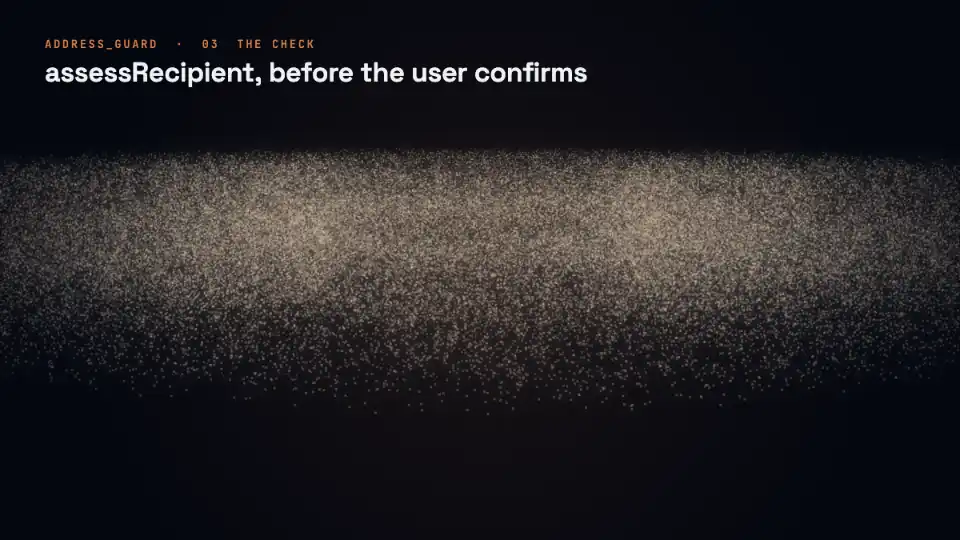
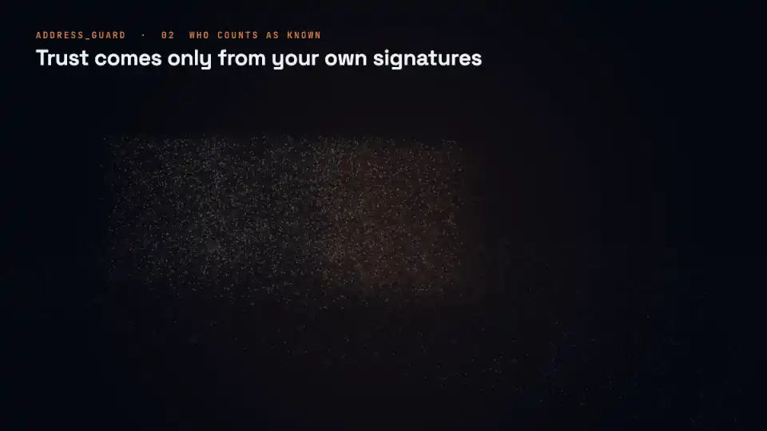

# address_guard

Catch address-poisoning look-alikes before a Flutter wallet sends.

`address_guard` marks the fake transfers an attacker plants in a wallet's history, compares the address a user is about to pay with the addresses that user has really paid before, checks its EIP-55 checksum, and shows it on a confirm card that makes the difference visible. It is pure Dart plus one Flutter widget: no native code, no network calls, no keys and no storage.

![Animation, landscape, split in two. On the left, without the package: a wallet history shows a payment to 0xa1b2…5678 and a planted zero-value transfer to a look-alike that reads the same when shortened; the user copies the look-alike and the payment is sent to the attacker, which cannot be reversed. On the right, with address_guard: the same history marks the planted entry as suspected poisoning, and when the look-alike is pasted anyway the confirm card shows all 40 characters with the differing middle highlighted and offers no confirm button. Every address is synthetic.](https://raw.githubusercontent.com/globalmpc/rwa-kit-flutter/main/packages/address_guard/doc/without-and-with.gif)

```sh
flutter pub add address_guard
```

## The problem: address poisoning

An EVM address is 40 hexadecimal characters. Nobody reads 40 characters, so wallets shorten them to the first and last few, `0xa1b2...5678`, and people check only those. Address poisoning is built on exactly that habit:

1. **You pay someone.** Your wallet history now shows the recipient, `0xa1b2c3d4...12345678`, usually shortened.
2. **An attacker generates a look-alike.** They search for an address with the same first four and last four characters and a different middle: `0xa1b2ffff...ffff5678`. Matching eight hex characters takes about 4.3 billion candidates on average (16 to the power 8), a search ordinary hardware can run.
3. **They put it in your history.** They send you a tiny amount, a worthless token, or a zero-value transfer from the look-alike. A zero-value one does not even need their own funds: on most tokens, calling `transferFrom(you, lookalike, 0)` succeeds without your approval and emits a `Transfer` event that names *you* as the sender, because ERC-20 requires the event even for a zero amount and an allowance of zero covers a transfer of zero. Explorers and wallets then show it as if you had sent money to the look-alike.
4. **You copy the wrong one.** Next time you pay, you copy the recipient from your history. Shortened, the real address and the look-alike are identical. The payment goes to the attacker, and a blockchain transfer cannot be reversed.

This is not a rare edge case. A study published at USENIX Security 2025 measured address poisoning on Ethereum and BNB Smart Chain between 1 July 2022 and 30 June 2024: more than 270 million attack attempts, aimed at 17 million victims, and 6,633 successful transfers to attackers worth at least USD 83.8 million ([Tsuchiya et al., "Blockchain Address Poisoning"](https://www.usenix.org/system/files/usenixsecurity25-tsuchiya.pdf)). Of the planted transfers, 55% were zero-value, 44% used a counterfeit token, and 1.5% were tiny real amounts. The look-alikes it found share at least three characters at the start and four at the end, and the best-funded attackers matched up to 20.

A 2025 study of 53 Ethereum wallets found that only 11 showed any warning or confirmation step before a send, mostly for any unfamiliar address rather than for a look-alike, and that only one labelled planted transfers as scams ([Guan and Li](https://arxiv.org/abs/2508.12107)). Both papers recommend the same two things: mark the planted transfers in the history, and stop the send to a look-alike. This package does both.

Two things make it hard to catch by hand: the look-alike really is in the user's history, and the part that differs is the part every interface hides.


## What this package does

- **Marks the planted transfers.** `screenHistory` finds the entries of the activity list whose counterparty imitates someone the user has paid or saved: the zero-value, counterfeit-token and dust transfers of step 3. The wallet can hide them or label them before the user copies from there.
- **Knows who the user has really paid.** It reads the transactions the user's own account signed and keeps only the recipients those signatures named. The planted transfer of step 3 never counts, because the user did not sign it.
- **Flags a look-alike.** A recipient with the same first and last characters as a known recipient (at least three and four), but a different middle, is a `lookalike`: the pattern of the attack, and a reason to stop. So is any address `screenHistory` caught planting a transfer.
- **Checks the checksum.** A mixed-case address carries an EIP-55 checksum; casing that contradicts it means a character was changed. All lower case or all capitals carries none, and is fine.
- **Shows the whole address.** `RecipientConfirmCard` prints all 40 characters in groups of four, sets the middle in bold, highlights every character that differs from the imitated address, and will not confirm a look-alike.
- **Binds the confirmation.** What the user confirmed is one exact address on one exact chain, checked again just before signing.




## Check a recipient

```dart
import 'package:address_guard/address_guard.dart';

// 1. Who has this user really paid? From the transactions the wallet already has for the
//    account: its own sends, with the receipt status. Add the user's address book too.
final known = [
  ...deriveKnownRecipients(account, sentTransactions),
  for (final entry in addressBook)
    KnownRecipient(entry.address, RecipientProvenance.confirmedByUser, label: entry.name),
];

// 2. Mark the planted entries in the activity list.
final suspects = screenHistory(account, activity, known: known, listedTokens: myTokens);

// 3. Judge the address the user entered or pasted.
final check = assessRecipient(input.trim(), known: known, suspects: suspects);
check.verdict; // known, firstTime, lookalike, invalid or badChecksum

// 4. Show it, and let the user confirm.
RecipientConfirmCard(
  check: check,
  chainId: 56,
  networkName: 'BNB Smart Chain',
  onConfirm: (confirmed) => setState(() => _confirmed = confirmed),
  onCancel: () => Navigator.pop(context),
);

// 5. Just before signing, make sure the payment still goes where the user confirmed. For a
//    token payment the recipient is inside the calldata; `to` is the token contract.
final recipient = isTokenPayment
    ? decodeErc20Transfer(calldata)?.recipient
    : transactionTo;
if (recipient == null || _confirmed?.matches(recipient, chainId) != true) {
  // The recipient or the chain changed after the user looked: ask again.
}
```

A `SentTransaction` is the wallet's own record of something it broadcast: `from`, `to`, the native `value`, the calldata `input`, and whether the receipt succeeded. The package makes no RPC call; it judges the data the app gives it.

> **Build `SentTransaction` from the transactions themselves, never from a token-transfer list.** Use the wallet's own record of what it signed, or `eth_getTransactionByHash` with the receipt status. An indexer's "token transfers" endpoint and `Transfer` logs name a sender that anyone can forge; a record built from them would let a planted look-alike pass as a payment the user made, which is the one thing this package exists to stop. For an ERC-20 payment, `to` is the token contract and `input` is the `transfer` calldata.

## Who counts as a known recipient



Getting this right is the whole point, because an attacker's goal is to become one. `deriveKnownRecipients(owner, transactions)` keeps a recipient only when all of these hold:

| Condition | Why |
|---|---|
| The transaction's own `from` is the owner | Only the owner's signature shows the owner's intent. A transfer *into* the account, or a log that merely names the owner, is something anyone can create. |
| The transaction succeeded | A reverted transaction moved nothing. |
| The owner's signed data names the recipient | Either a native send (empty calldata, `to` is the recipient) or a direct `transfer(address,uint256)` call on the token, decoded strictly. |
| A non-zero amount, at least `minNativeValue` or `minTokenAmount` when given | A zero transfer is not a payment, whatever the minimum is set to. |

What is left out on purpose:

- **Token `Transfer` logs.** A log's `from` is an indexed topic that any contract call can make name any account; that is the poisoning step itself.
- **`transferFrom`, `approve`, multisend, Safe and every other contract call.** The user signed a call to a contract, and the contract decided where the money went. Signing is not choosing a recipient.

Pass the transactions of the chain the payment is on. An address is the same string on every EVM chain, but a contract or Safe at that address can belong to someone else on another chain, so a recipient paid on one chain is not known on another.

The cost is that recipients paid through those routes stay first-time recipients. Add them to the address book as `RecipientProvenance.confirmedByUser` once the user has checked them. A first-time verdict is the safe answer to get wrong; a known one is not.

`recipientNamedBy(transaction, owner: ...)` applies the same rule to one record, for an app that wants to explain a single entry, and `decodeErc20Transfer(calldata)` is the strict decoder it uses.

## Screen the activity list

The poisoning only works if the user copies the look-alike from the history, so the history is the first place to warn. `screenHistory(owner, activity, known: known)` takes the transfers the wallet shows, as `HistoryTransfer` (`from`, `to`, `amount`, and `token`, or null for the native coin), and returns a `PoisoningSuspect` for each entry whose counterparty imitates a known recipient:

```dart
final suspects = screenHistory(
  account,
  activity,
  known: known,
  listedTokens: myTokens,                       // the real token contracts the wallet shows
  isDust: (transfer) => usdValue(transfer) < 1, // optional: what is too small to be a payment
);
for (final suspect in suspects) {
  suspect.index;        // which entry of `activity`
  suspect.counterparty; // the look-alike
  suspect.imitates;     // the known recipients it copies, closest first
  suspect.signs;        // zeroValue, dust, unlistedToken, namesOwnerAsSender
}
```

| Sign | Meaning |
|---|---|
| `zeroValue` | An amount of zero. A zero-value `transferFrom` needs no approval, so anyone can make a log that shows the owner paying the look-alike. |
| `dust` | An amount the app's `isDust` judged too small to be a real payment. |
| `unlistedToken` | A token contract missing from `listedTokens`. A counterfeit can copy USDT's name and symbol, never its contract address. |
| `namesOwnerAsSender` | A token record shows the owner paying the look-alike. A forged log reads exactly like this. Never set for the native coin, whose sender cannot be forged. |

A look-alike is a suspect on its own; the signs explain it. `AddressGuardStrings.historyWarning` and `strings.sign(sign)` give the text for the entry.

This is the data the trust rule refuses: token logs and incoming transfers that anyone can forge. It is safe here because it can only raise an alarm. Nothing `screenHistory` reads makes an address known, and an entry whose counterparty the owner has really paid is never flagged. A counterparty that is only in the address book is still flagged, because copying the look-alike from the history into the address book is how the attack succeeds. Two saved addresses that resemble each other therefore flag each other: nothing says which one is real, and a false alarm is the safe mistake. Pass the transfers and the known recipients of one account on one chain. Pass the result to `assessRecipient` as `suspects`, and an address copied from such an entry is a `lookalike` with the reason `plantedInHistory`, shown on the card next to the address it imitates. That holds even if it was saved since, and even if the user's known recipients have changed since the history was screened.

## The verdicts

`assessRecipient` runs the checks in order of how much each should stop a payment, and the first that decides wins:

| Verdict | When | Card |
|---|---|---|
| `invalid` | Not `0x` followed by 40 hex characters. Surrounding whitespace counts as invalid: trim first, so nothing the user cannot see is accepted. | Shown as typed, no confirm button |
| `known` | An exact known recipient, in any valid casing. Titled "paid before" for a recipient from the user's own sends, "in your address book" for one only saved. A saved address that `screenHistory` flagged is a `lookalike` instead. | Confirm at once |
| `lookalike` | At least three first and four last characters in common with a known recipient (or another entry of the batch), different middle; or flagged in `suspects` | Not confirmable; the imitated addresses are shown with the differences highlighted |
| `badChecksum` | Mixed case that contradicts the EIP-55 checksum, including a known address whose casing was edited. All lower case and all capitals carry no checksum: they get a "no checksum to verify" note, never this verdict. | Not confirmable |
| `firstTime` | Anything else | Confirm after the user ticks that they checked the full address |

Two orderings are deliberate. An exact known match outranks resemblance, because flagging a recipient the user really pays teaches people to ignore the warning. A look-alike outranks a checksum complaint, because both mean "do not send" and the casing would hide the dangerous half. A known address whose casing was altered is reported as `badChecksum`, not `known`: correct bytes in a spelling no tool produces still mean someone edited it.

An address that is both paid and in the address book is reported with the address-book entry, so its label shows on the card, also when its casing was edited. There is no `safe` verdict. `check.reasons` lists every finding in order, as `RecipientReason` values with English sentences in `AddressGuardStrings`, and `check.lookalikes` names each imitated address with the shared and differing parts.

The comparison window is a minimum: at least three characters at the start and four at the end by default, where the measured attacks begin. A look-alike that copies more, six and six for example, is found too, and `LookalikeMatch.prefix` and `suffix` hold everything it shares, closest copy first. If your wallet shortens addresses to fewer characters, for example two at the start, pass that as `prefixLength`, since that is what an attacker needs to match for your users. A window that leaves no middle is refused with an `ArgumentError`.

## The confirm card

`RecipientConfirmCard` is the moment the user decides, so it shows what a shortened address hides:

- all 40 characters, in groups of four, never truncated, wrapping on narrow screens and at large text sizes;
- the characters between the compared ends in bold, and, for a look-alike, the imitated addresses underneath (up to three, the rest counted), each with the characters that differ from the candidate highlighted, and the candidate highlighted against the first;
- the reasons in plain language, and the network the payment is on;
- for a screen reader, the address spelled out character by character in groups, as its own node.

`allowOverride: true` lets a user confirm a look-alike or an altered address after ticking an explicit override. It is off by default, because both verdicts mean "do not send".

`onConfirm` is called at most once while the card shows the same check on the same chain. If what the user's decision rested on changes while the card is open (the address or its casing, the verdict, the addresses it imitates, the chain, or `allowOverride`), any tick is cleared and the user must confirm again. A parent that rebuilds with an equal check keeps the tick. To ask again for the same address, give the card a new `Key`. `AddressText` is the address display on its own, for wallets that build their own layout.

## Payout lists

To check a list of recipients, pass the other rows as `batch`:

```dart
final checks = [
  for (final (index, row) in rows.indexed)
    assessRecipient(
      row,
      known: known,
      batch: [for (final (other, entry) in rows.indexed) if (other != index) entry],
    ),
];
```

A row that resembles another row is flagged as a `lookalike` with `MatchSource.sameBatch`, but a batch match never makes an address known: only the user's own history does. Rows that are not addresses are skipped as batch entries, so one typo does not stop the other rows from being checked; that row's own check reports it as `invalid`. Each check compares the row with every other row, which is quick for the lists a person reviews by hand. With the default window of three and four, two unrelated addresses match by chance about once in 270 million pairs; a 1,000-row list has about 500,000 pairs, so roughly one list in 500 stops on a chance match. For long machine-made lists, pass `prefixLength: 4` to make that sixteen times rarer.

## Text and languages

Every string on the card has an English default and can be replaced through `AddressGuardStrings`. Texts that carry a value are functions:

```dart
final strings = AddressGuardStrings(
  titleLookalike: 'Diese Adresse imitiert einen bekannten Empfänger',
  confirm: 'Empfänger bestätigen',
  network: (name, chainId) => 'Netzwerk: ${name ?? 'Chain'} (Chain-ID $chainId)',
);
```

`strings.reason(reason)` and `strings.title(verdict)` give the sentence for any result, for a wallet that shows verdicts outside the card.

## API

| Name | Purpose |
|---|---|
| `screenHistory(owner, activity, known:, listedTokens?, isDust?, prefixLength?, suffixLength?)` | The activity entries that look like poisoning, as `PoisoningSuspect` with their `PoisoningSign`s. |
| `HistoryTransfer` | One activity entry: `from`, `to`, `amount`, `token` (null for the native coin). |
| `deriveKnownRecipients(owner, transactions, minNativeValue?, minTokenAmount?)` | The recipients the owner's own signatures named, deduplicated, first seen first. |
| `SentTransaction` | One transaction the account sent: `from`, `to`, `value`, `input`, `succeeded`. |
| `KnownRecipient(address, provenance, label?)` | A recipient with `RecipientProvenance.sentByOwner` or `confirmedByUser`. |
| `assessRecipient(candidate, known:, batch?, suspects?, prefixLength?, suffixLength?)` | The verdict, reasons and look-alike evidence for one address. Returns `RecipientCheck`. |
| `RecipientConfirmCard` | The confirm card. Returns a `ConfirmedRecipient` through `onConfirm`. |
| `ConfirmedRecipient.matches(address, chainId)` | Whether a transaction is the one the user confirmed. |
| `AddressText` | The full address in groups, with optional difference highlighting. |
| `findLookalikes(candidate, others, prefixLength?, suffixLength?, source?)` | The look-alike matcher on its own, closest copy first. |
| `recipientNamedBy`, `decodeErc20Transfer` | The trust rule for one record, and its strict `transfer(address,uint256)` decoder. |
| `toChecksumAddress`, `checksumState`, `isValidChecksum`, `isEvmAddress`, `normalizeAddress` | EIP-55 and address helpers. `checksumState` separates `checksummed`, `unchecksummed` (one case throughout, nothing to verify) and `mismatch`. |
| `AddressGuardStrings` | All user-facing text, for the card and for flagged history entries. |

## What it does not do

- **Prove an address is safe.** A known recipient is one the user chose before, not a guarantee about who controls it now. A first-time recipient is not suspicious, only unverified.
- **Catch every substitution.** It catches an address that copies the ends of one the user has paid, and one caught planting a transfer. An attacker who replaces the whole address, for example clipboard malware, produces a first-time recipient: the card then asks the user to check the full address, but it cannot know it is wrong.
- **Read the chain, or know token prices.** It judges the records the app supplies. Whether a token is real (`listedTokens`) and what amount is dust (`isDust`) are the app's to say. A wallet that keeps no history of its own sends can still use the address book and the checksum check.
- **Undo a past mistake.** Once the user has really paid a look-alike, it is a known recipient like any other, and its history entries are no longer flagged. The other known recipient it copies still shows `othersShareEnds` when it is checked.
- **Stop a determined user.** With `allowOverride`, the user can confirm after an explicit tick; without it, the app decides what happens next.
- **Store anything, call the network, or hold keys.**

## Development

```sh
cd packages/address_guard
flutter pub get
dart format --output=none --set-exit-if-changed .
flutter analyze --fatal-infos
flutter test
flutter pub publish --dry-run
```

Tests cover the EIP-55 specification vectors, the look-alike matcher with property tests (changing any middle character always flags, changing one of the first three or last four never does), the history screen against each kind of planted transfer and the entries it must never flag, the trust rule against forged, reverted, zero-value and contract-call records, the verdict order, and the card: each verdict, a double tap, a recipient swapped while the card is open, screen-reader labels and double text size on a narrow screen. Every address in the tests is synthetic. The example app shows the whole flow with a planted look-alike; `cd example && flutter test` drives it end to end.

## License

MIT. See [LICENSE](LICENSE).

---

Maintained by [Global MPC (Mineral Project Coin)](https://globalmpc.tech). $MPC remains at the Pre-TGE stage, and no token contract address has been published. Official site: https://globalmpc.tech
